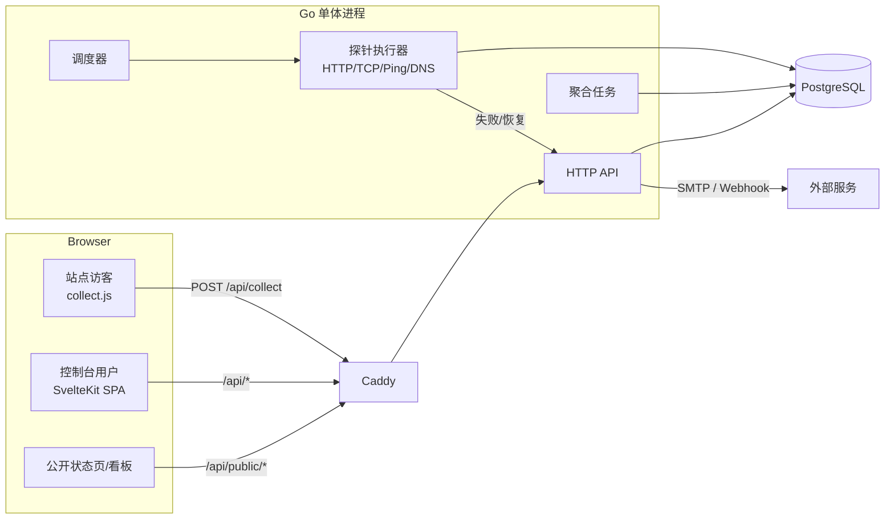
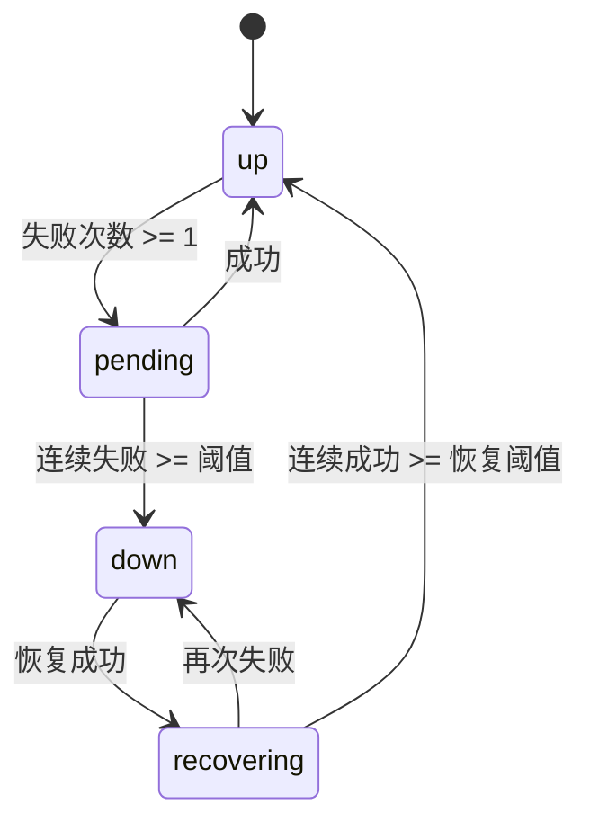

# Yu —— 轻量网站统计 + 服务监控

## 1. 项目概述

Tianji.dev 的精简版：只保留**网站统计**（含短链追踪）与**服务监控**两大模块，去掉 Server Status、Docker Status、Telemetry、Survey、Feeds、AI Gateway 等附加能力。

目标：单体可部署、轻量、低资源占用，面向独立开发者与小型团队。

### 非目标

- 不做分布式多地域探针（B13）
- 不做漏斗 / 留存 / 用户路径分析（A12）
- 不做短链管理之外的附加能力（Survey、Telemetry 等）
- 不做 Cookie 追踪（统计使用 localStorage 生成的 visitor_id）

## 2. 功能范围（已确认）

### 2.1 网站统计

| 编号 | 功能 |
|---|---|
| A1 | 基础指标：PV、UV、会话数、跳出率、平均停留时长 |
| A2 | 页面维度：热门页面、入口页、退出页、页面标题 |
| A3 | 来源分析：Referrer、UTM 参数、渠道分组 |
| A4 | 访客画像：设备类型、浏览器、OS、屏幕尺寸、语言、国家/地区 |
| A5 | 实时访客：最近 30 分钟在线人数与当前页面 |
| A6 | 趋势图：按小时/天/周/月聚合，本期 vs 上期对比 |
| A7 | 自定义事件：事件名 + 属性（字符串/数值），事件趋势与排行 |
| A8 | 多站点：站点管理 + 每站独立采集 token |
| A10 | 公开看板：只读分享链接（可设密码） |

### 2.2 服务监控

| 编号 | 功能 |
|---|---|
| B1 | HTTP(S) 探测：状态码、响应时间、重定向、自定义 Header、请求方法与请求体 |
| B2 | TCP 端口探测：连通性 + 握手耗时 |
| B3 | Ping / ICMP 探测 |
| B4 | DNS 探测：指定记录类型 + 期望值校验 |
| B5 | 断言校验：状态码范围、响应体包含/不包含、JSONPath、耗时阈值 |
| B6 | 调度配置：探测间隔、超时、失败重试 |
| B7 | 可用性统计：up/down 时间轴、24h/7d/30d 可用率、响应时间 P50/P95/P99 |
| B8 | 告警通知：邮件 SMTP、通用 Webhook |
| B9 | 告警策略：连续 N 次失败触发、恢复通知、静默期、维护窗口抑制 |
| B10 | 公开状态页：组件分组、整体状态、历史故障 |
| B11 | 事件管理：自动故障记录 + 手动 incident、维护窗口 |
| B12 | SSL 证书到期提醒 |
| B14 | 分组与标签 |

### 2.3 系统能力

- 多用户 + 工作区（角色：owner / admin / member）
- 邀请制注册（无开放注册）
- API Key + REST API
- 深色 / 浅色主题
- 界面语言：仅中文
- Postgres 存储，原始数据永久保留

## 3. 技术选型

### 后端

| 项 | 选型 |
|---|---|
| 语言 | Go 1.23+ |
| HTTP 路由 | chi |
| 数据库 | PostgreSQL 15+，驱动 pgx/v5 |
| 查询层 | pgx/v5 + 手写 SQL（集中在 store 包） |
| 迁移 | 内嵌 SQL 迁移 + `schema_migrations` 表，启动时自动执行 |
| 调度 | 进程内调度器 + Postgres advisory lock（多实例只允许一个主调度） |
| 认证 | HttpOnly Session Cookie（DB 存储 session） + CSRF Token |
| 密码 | argon2id |
| 邮件 | net/smtp |
| GeoIP | MaxMind GeoLite2 本地库（可选启用） |
| 日志 | slog（JSON 输出） |

### 前端

| 项 | 选型 |
|---|---|
| 框架 | SvelteKit 3 + `@sveltejs/adapter-static`（SPA 模式，`fallback: index.html`；配置写在 `vite.config.ts`） |
| 版本 | Svelte 5（runes 语法：`$state` / `$derived` / `$effect`） |
| 语言 | TypeScript |
| 日期 | Luxon |
| 图表 | ECharts（按需引入，`echarts/core`） |
| 样式 | 原生 CSS + CSS 变量（主题切换） |

后端与前端完全分离，后端只提供 JSON API，静态文件由 Caddy 托管并反向代理 `/api/*`。

## 4. 仓库结构

```text
yu/
├── backend/
│   ├── cmd/server/main.go
│   ├── internal/
│   │   ├── config/          # 环境变量配置
│   │   ├── httpapi/         # 路由、handler、中间件
│   │   ├── auth/            # session、密码、邀请
│   │   ├── analytics/       # 采集、指标查询、UA 解析
│   │   ├── monitor/         # 探针实现、调度器、聚合
│   │   ├── notify/          # 邮件、webhook
│   │   ├── store/           # 数据访问（pgx + 手写 SQL）
│   │   └── worker/          # 后台任务（聚合、分区维护、调度）
│   └── migrations/          # 内嵌 SQL 迁移
├── frontend/
│   ├── src/
│   │   ├── lib/api/         # fetch 封装与类型
│   │   ├── lib/components/  # 通用组件、图表封装
│   │   ├── lib/stores/      # 会话、工作区、主题
│   │   └── routes/
│   ├── static/collect.js    # 采集脚本（前端静态托管）
│   ├── vite.config.ts
│   └── package.json
├── design.md
└── README.md
```

## 5. 系统架构



## 6. 数据库设计

### 6.1 账号与工作区

```sql
users (
  id uuid pk, email citext unique not null, password_hash text not null,
  name text not null, created_at timestamptz default now()
)
sessions_auth (
  id text pk, user_id uuid fk, expires_at timestamptz, created_at timestamptz
)
invites (
  id uuid pk, workspace_id uuid fk, email citext, role text,
  token_hash text, expires_at timestamptz, accepted_at timestamptz
)
workspaces (id uuid pk, name text, slug text unique, created_at timestamptz)
workspace_members (
  workspace_id uuid fk, user_id uuid fk, role text,  -- owner/admin/member
  primary key (workspace_id, user_id)
)
api_keys (
  id uuid pk, workspace_id uuid fk, name text,
  key_prefix text, key_hash text, created_at timestamptz, last_used_at timestamptz
)
```

### 6.2 网站统计

```sql
sites (
  id uuid pk, workspace_id uuid fk, name text, domain text,
  token text unique,              -- 采集 token
  share_token text unique,        -- 公开看板 token
  share_password_hash text,       -- 可选
  timezone text default 'UTC',
  created_at timestamptz
)

-- 按月声明式分区，后台任务提前创建未来 2 个月分区
events (
  id bigserial, site_id uuid not null, created_at timestamptz not null,
  type text not null,             -- pageview | custom
  name text,                      -- 自定义事件名
  visitor_id text not null,
  session_id text not null,
  url text, path text, title text,
  referrer text, referrer_host text,
  utm_source text, utm_medium text, utm_campaign text,
  channel text,                   -- direct/search/social/referral/email
  browser text, os text, device text,
  screen text, language text, country text,
  props jsonb,                    -- 自定义事件属性
  primary key (id, created_at)
) partition by range (created_at);

create index on events (site_id, created_at);
create index on events (site_id, path, created_at);
create index on events (site_id, visitor_id, created_at);
create index on events (site_id, session_id);
create index on events (site_id, type, name, created_at);

sessions_web (
  site_id uuid, session_id text, visitor_id text,
  started_at timestamptz, last_seen_at timestamptz,
  pageviews int, entry_path text, exit_path text,
  primary key (site_id, session_id)
)

-- 每日聚合，长周期查询走这里；原始 events 永久保留
site_stats_daily (
  site_id uuid, day date, timezone text,
  pv bigint, uv bigint, sessions bigint, bounces bigint, duration_sum bigint,
  primary key (site_id, day)
)
```

### 6.3 短链追踪

短链绑定到某个站点，点击作为 `events.type = 'link_click'` 写入，复用现有统计与事件面板；短链点击不计入站点 PV。

```sql
short_links (
  id uuid pk,
  workspace_id uuid fk,
  site_id uuid fk,
  slug text unique,               -- 默认随机 8 位 base62，也可自定义
  target_url text not null,
  title text,
  enabled boolean default true,
  expires_at timestamptz,         -- 可空
  created_at timestamptz default now()
)

create index on short_links (site_id);
```

跳转流程：`GET /s/{slug}` → 校验启用与过期 → 合并 query（UTM 透传）→ 302 到目标地址 → 异步写入一条 `link_click` 事件（`name` = slug、`path` = `/s/{slug}`、`url` = 最终地址）。访客标识用 `sha256(ip + UA)`，会话标识为「访客标识 + 日期」，避免依赖采集脚本的 localStorage。过期或停用返回 410 页面。

短链是跨站跳转，渠道判定**不以绑定站点作为 internal 基准**：从自己的博客/官网点出去按来源域名记为 referral（或按 UTM 归类），否则会被误判成 `internal`。

管理端在列表展示点击 / UV / 最近点击与目标域名（标注站内 / 站外），并提供详情面板：点击趋势、来源、渠道、UTM 来源与活动、设备、浏览器分布，以及最近 50 条点击明细。

### 6.3.1 遥测（像素上报）

用于**无法注入 `collect.js`** 的场景（第三方平台文章、README、邮件、落地页），在页面里嵌一个 1px 透明图，页面被打开即记录一次曝光。

与短链共用「一次请求 = 一条事件」的机制，但**独立建模**：像素没有目标地址，语义是曝光而不是点击，后续演进方向也不同（嵌入方式、防刷、缓存策略）。因此不复用 `short_links`，避免 `target_url` 变成「一种类型必需、另一种用不上」的字段。

```sql
pixels (
  id uuid pk,
  workspace_id uuid fk,
  site_id uuid fk,
  slug text unique,               -- 默认随机 8 位，也可自定义
  name text,                      -- 展示名
  enabled boolean default true,
  expires_at timestamptz,         -- 可空
  created_at timestamptz default now()
)

create index on pixels (site_id);
```

采集流程：`GET /t/{slug}.gif` →

1. 限流（复用采集限流器，120/min/IP）
2. 查 `pixels`，校验启用与过期
3. 命中则异步写入一条 `pixel` 事件（`name` = slug、`path` = `/t/{slug}.gif`、`url` = 完整像素地址）
4. **无论 slug 是否存在、是否停用，都返回 200 + 1px GIF**，响应头带 `Cache-Control: no-store, no-cache, must-revalidate`

第 4 点是有意的设计：像素挂在别人页面里，返回 404 会出现破图；同时避免被用来枚举有效标识。停用或过期的像素只是不记事件。

query 参数全部参与解析（`utm_source` / `utm_medium` / `utm_campaign` 与 referrer），用于区分同一篇内容的多个投放位置；展示名一律取表里的 `name`，不接受 query 覆盖，避免被伪造。

访客标识、会话标识、渠道判定与 UA 解析与短链完全一致，抽成公共的 `recordHit` 供两者调用。

已知偏差（行业通病，需在文档说明）：

- 邮件客户端常预加载图片，曝光会偏高
- 微信、知乎等平台代理图片，referrer 与 IP 会变成平台侧，来源分析失真
- 浏览器缓存会吞掉重复曝光，靠 `no-store` 缓解但不能完全避免

### 6.4 服务监控

```sql
monitors (
  id uuid pk, workspace_id uuid fk, name text,
  type text not null,              -- http | tcp | ping | dns
  config jsonb not null,
  interval_sec int not null default 60,
  timeout_ms int not null default 10000,
  retries int not null default 0,
  group_name text, tags text[],
  ssl_alert_days int default 14,
  enabled boolean default true,
  next_run_at timestamptz,
  created_at timestamptz
)

-- 按月分区
monitor_checks (
  id bigserial, monitor_id uuid not null, checked_at timestamptz not null,
  status text not null,            -- up | down
  latency_ms int, status_code int, error text,
  cert_expires_at timestamptz,
  primary key (id, checked_at)
);

monitor_stats_hourly (
  monitor_id uuid, bucket timestamptz,
  total int, up_count int,
  p50 int, p95 int, p99 int,
  primary key (monitor_id, bucket)
)

notification_channels (
  id uuid pk, workspace_id uuid fk, type text,  -- smtp | webhook
  name text, config jsonb, enabled boolean, created_at timestamptz
)

alert_states (
  monitor_id uuid pk,
  state text,                      -- up | pending | down | recovering
  consecutive_failures int default 0,
  consecutive_successes int default 0,
  since timestamptz,
  down_since timestamptz,
  last_notified_at timestamptz,
  muted_until timestamptz,
  incident_id uuid
)

incidents (
  id uuid pk, workspace_id uuid fk, monitor_id uuid null,
  title text, body text, severity text,   -- minor/major/critical
  source text,                     -- auto | manual
  started_at timestamptz, resolved_at timestamptz
)

maintenance_windows (
  id uuid pk, workspace_id uuid fk, title text,
  monitor_ids uuid[], starts_at timestamptz, ends_at timestamptz
)

status_pages (
  id uuid pk, workspace_id uuid fk, slug text unique, name text,
  description text, password_hash text, theme text,
  created_at timestamptz
)
status_page_items (
  status_page_id uuid fk, monitor_id uuid fk, display_name text,
  group_name text, sort_order int,
  primary key (status_page_id, monitor_id)
)
```

### 6.5 监控配置 jsonb 结构

```jsonc
// http
{ "url": "https://x", "method": "GET", "follow_redirects": true, "max_redirects": 5,
  "headers": {"Key":"Value"}, "body": "{\"ping\":true}", "expected_status": [200,299],
  "body_contains": "...", "body_not_contains": "...",
  "json_path": "$.status", "json_equals": "ok",
  "max_latency_ms": 2000 }

// tcp
{ "host": "db.local", "port": 5432 }

// ping
{ "host": "1.1.1.1", "count": 3 }

// dns
{ "server": "", "name": "example.com", "record_type": "A", "expected_values": ["1.2.3.4"] }
```

## 7. 统计采集协议

### 7.1 采集脚本

- 单文件 `collect.js`，目标 < 4KB gzip，零依赖。
- 页面加载后发送 `pageview`；SPA 场景监听 `history.pushState/replaceState` 与 `popstate` 触发页面切换上报。
- 使用 `navigator.sendBeacon`，失败降级 `fetch(..., {keepalive:true})`。
- `visitor_id`：前端生成 UUID 并写入 `localStorage`（`yu_vid`），随每次上报携带；服务端不依赖 Cookie。
- `session_id`：前端维护 session_id，30 分钟无事件自动新建，与后端判定口径一致。
- 页面隐藏 / 离开时发送一次 `ping` 用于更新停留时长（`unload` 事件，携带 `session_id` 与 `last_seen`）。

### 7.2 上报请求

```http
POST /api/collect
Content-Type: text/plain            // 避免 CORS 预检
Body: {"t":"<site token>","type":"pageview","url":"...","ref":"...","props":{}}
```

响应：`204 No Content`。`sendBeacon` 无法读取响应体，因此 visitor_id 由前端生成。

服务端职责：

1. 校验 token、Origin / Host（与站点 domain 匹配，可配置宽松模式）
2. 按 IP + token 限流（令牌桶，60 req/min/IP）
3. User-Agent 解析（浏览器、OS、设备）；IP 仅用于 GeoIP 查询后丢弃
4. 计算 `channel`（UTM 优先，其次 referrer_host，无 referrer 为 direct）
5. 写 `events`，UPSERT `sessions_web`
6. 回填 `visitor_id`

### 7.3 指标口径

| 指标 | 定义 |
|---|---|
| PV | `type='pageview'` 的 event 数 |
| UV | 区间内 `count(distinct visitor_id)` |
| 会话数 | `sessions_web` 中 `started_at` 落在区间内的记录数 |
| 跳出率 | 会话 `pageviews = 1` 的占比 |
| 平均停留时长 | 区间内会话 `(last_seen_at - started_at)` 之和 / 会话数；单一页面会话若停留 < 1s 按 0 计 |
| 实时访客 | 最近 30 分钟内出现的 `distinct visitor_id` |
| 可用率 | `up_count / total` |
| P50/P95/P99 | `percentile_cont` 基于 `latency_ms`，仅统计 `status='up'` |

## 8. 监控调度与告警状态机

### 8.1 调度

- 单表轮询：调度器每 2 秒执行 `select ... where enabled and next_run_at <= now() for update skip locked limit 50`。
- 每个监控探测完成后写 `monitor_checks` 并更新 `next_run_at = now() + interval`。
- 并发上限可配置（默认 32），单监控串行。
- 多实例：拿到 advisory lock（`pg_try_advisory_lock`）的实例才运行调度器，其余待命。

### 8.2 告警状态机



- `up`：正常
- `pending`：失败计数中，不通知
- `down`：已通知，写入 `incidents`（`source='auto'`）
- `recovering`：已恢复但未达恢复阈值，不通知
- 通知去重：同一监控同一状态 `last_notified_at` 距今小于间隔（默认 30 分钟）不再发送
- 维护窗口内：照常探测与记录，但不通知、不创建 incident
- 静默（`muted_until`）：不通知，但状态与 incident 正常维护

### 8.3 通知渠道

每个工作区可配置多个渠道，告警会同时发送到全部启用渠道。

```jsonc
// smtp：连接信息在渠道内配置，未填 host 时回退到环境变量
{ "host": "smtp.example.com", "port": 587, "username": "no-reply@example.com",
  "password": "...", "from": "Yu <no-reply@example.com>",
  "to": ["ops@example.com"] }

// webhook
{ "url": "https://hooks.example.com/yu", "secret": "optional", "headers": {"X-Token": "..."} }
```

Webhook 请求体：

```json
{
  "event": "monitor.down",
  "workspace": "默认工作区",
  "status": "down",
  "latency_ms": 0,
  "error": "connection refused",
  "checked_at": "2026-10-18T12:33:43Z",
  "cert_expires_at": null,
  "days_left": 0,
  "monitor": { "name": "官网", "type": "http", "target": "https://example.com" }
}
```

配置了 `secret` 时附加 `X-Yu-Signature: sha256=<hmac>`。

- 新进入 `down` 状态立即通知；持续 `down` 时每 30 分钟重复一次
- `up` 通知只在「down → recovering → up」完成后发送一次
- 静默与维护窗口抑制通知，维护窗口内也不创建事件
- 维护窗口 `monitor_ids` 为空表示覆盖工作区全部监控

### 8.4 SSL 提醒

HTTP 探测时读取 `TLS.PeerCertificates[0].NotAfter` 写入 `cert_expires_at`。当剩余天数 ≤ `ssl_alert_days` 且当天未提醒过，发一次提醒（独立去重键）。

## 9. API 设计

统一前缀 `/api`，认证方式：

- 控制台：Session Cookie（`yu_session`）+ `X-CSRF-Token`
- 程序访问：`Authorization: Bearer <api_key>`
- 采集：站点 token 内置于 body（`/api/collect` 不受来源白名单限制，靠 token + 限流保护）
- 公开接口：无认证，按 token 只读

### 9.1 认证与工作区

| 方法 | 路径 | 说明 |
|---|---|---|
| POST | `/api/auth/login` | 登录 |
| POST | `/api/auth/logout` | 登出 |
| GET | `/api/auth/me` | 当前用户 + 工作区列表 |
| POST | `/api/auth/invite/accept` | 接受邀请并设置密码 |
| GET/POST | `/api/workspaces` | 列表 / 创建 |
| GET | `/api/workspaces/:id/members` | 成员列表 |
| POST | `/api/workspaces/:id/invites` | 邀请成员 |
| PATCH/DELETE | `/api/workspaces/:id/members/:userId` | 改角色 / 移除 |
| GET/POST/DELETE | `/api/workspaces/:id/api-keys` | API Key 管理 |

### 9.2 统计

| 方法 | 路径 | 说明 |
|---|---|---|
| GET/POST | `/api/workspaces/:wsId/sites` | 站点列表 / 创建 |
| GET/PATCH/DELETE | `/api/workspaces/:wsId/sites/:id` | 详情 / 编辑 / 删除 |
| GET | `/api/workspaces/:wsId/sites/:id/stats/overview?from=&to=` | 概览卡片 + 趋势 |
| GET | `/api/workspaces/:wsId/sites/:id/stats/realtime` | 实时（30 分钟） |
| GET | `/api/workspaces/:wsId/sites/:id/stats/pages?from=&to=` | 页面 / 入口 / 退出 |
| GET | `/api/workspaces/:wsId/sites/:id/stats/sources?from=&to=` | 来源、渠道、UTM |
| GET | `/api/workspaces/:wsId/sites/:id/stats/audience?from=&to=` | 设备 / 浏览器 / OS / 地区 |
| GET | `/api/workspaces/:wsId/sites/:id/stats/events?from=&to=` | 自定义事件排行 |
| GET | `/api/workspaces/:wsId/sites/:id/stats/events/:name` | 单事件属性分布与趋势 |
| POST | `/api/collect` | 数据上报 |

### 9.3 监控

| 方法 | 路径 | 说明 |
|---|---|---|
| GET/POST | `/api/monitors` | 列表 / 创建 |
| GET/PATCH/DELETE | `/api/monitors/:id` | 详情 / 编辑 / 删除 |
| GET | `/api/monitors/:id/checks?from=&to=` | 原始探测记录（分页） |
| GET | `/api/monitors/:id/stats?range=24h\|7d\|30d` | 可用率、响应时间、时间轴 |
| POST | `/api/monitors/:id/mute` | 静默 N 小时 |

### 9.4 告警、事件、维护

| 方法 | 路径 | 说明 |
|---|---|---|
| GET/POST | `/api/channels` | 告警渠道 |
| PATCH/DELETE | `/api/channels/:id` | 编辑 / 删除 |
| POST | `/api/channels/:id/test` | 发送测试消息 |
| GET/POST | `/api/incidents` | 事件列表 / 手动创建 |
| PATCH | `/api/incidents/:id/resolve` | 标记恢复 |
| GET/POST | `/api/maintenance-windows` | 维护窗口 |

### 9.5 状态页与公开看板

| 方法 | 路径 | 说明 |
|---|---|---|
| GET/POST | `/api/status-pages` | 状态页管理 |
| PATCH/DELETE | `/api/status-pages/:id` | 编辑 / 删除 |
| PUT | `/api/status-pages/:id/items` | 批量设置组件 |
| GET | `/api/public/status/:slug` | 公开状态页数据 |
| POST | `/api/public/status/:slug/unlock` | 密码校验 |
| GET | `/api/public/share/:token` | 公开统计看板数据 |

### 9.6 短链

| 方法 | 路径 | 说明 |
|---|---|---|
| GET/POST | `/api/workspaces/:ws/sites/:site/short-links` | 短链列表 / 创建 |
| PATCH/DELETE | `/api/workspaces/:ws/sites/:site/short-links/:id` | 编辑 / 删除 |
| GET | `.../short-links/stats` | 每个短链的点击量、UV、最近点击 |
| GET | `.../short-links/:id/stats?range=30d` | 单条短链的点击趋势与来源/渠道/UTM/设备分布 |
| GET | `/s/:slug` | 公开跳转（302），异步记录 click |

### 9.7 遥测像素

| 方法 | 路径 | 说明 |
|---|---|---|
| GET/POST | `/api/workspaces/:ws/sites/:site/pixels` | 像素列表 / 创建 |
| PATCH/DELETE | `/api/workspaces/:ws/sites/:site/pixels/:id` | 编辑 / 删除 |
| GET | `.../pixels/:id/stats?range=30d` | 曝光趋势与来源/渠道/UTM/设备分布 |
| GET | `/t/:slug.gif` | 公开像素（200 + 1px GIF），异步记录曝光 |

## 10. 前端设计

### 10.1 路由

```text
/login
/invite/[token]
/app                                    -> 重定向到第一个工作区
/app/w/[ws]/analytics                   -> 站点列表
/app/w/[ws]/analytics/[siteId]          -> 概览 / 实时 / 页面 / 来源 / 事件
/app/w/[ws]/sites                       -> 站点设置（含安装代码）
/app/w/[ws]/monitors                    -> 监控列表
/app/w/[ws]/monitors/[id]               -> 监控详情
/app/w/[ws]/alerts                      -> 告警渠道
/app/w/[ws]/incidents                   -> 事件与维护
/app/w/[ws]/status-pages                -> 状态页管理
/app/w/[ws]/short-links                 -> 短链管理（含二维码）
/app/w/[ws]/pixels                      -> 遥测像素管理（复制 img 片段）
/app/w/[ws]/settings                    -> 工作区设置（成员、API Key）
/status/[slug]                          -> 公开状态页
/share/[token]                          -> 公开看板
/s/[slug]                               -> 短链跳转（Go 直出，需反代）
```

SPA 使用 `adapter-static` + `fallback: 'index.html'`，所有路由由前端接管；Caddy 对 `/api/*` 反代到 Go，其他路径回退 `index.html`。

### 10.2 状态与数据

- 全局：当前用户、工作区列表、主题（`localStorage`）
- 页面数据：`$state` + 手写 `load` 函数，统一 `lib/api/client.ts` 处理错误、401 跳登录、CSRF
- 时间范围：`RangePicker`（1h/24h/7d/30d/自定义），所有时间戳用 Luxon 按站点时区渲染
- 图表：`LineChart`、`BarChart`、`Sparkline` 三个 ECharts 封装，暗色主题跟随 CSS 变量

### 10.3 权限

| 角色 | 权限 |
|---|---|
| owner | 全部，含删除工作区、转让所有权 |
| admin | 管理站点、监控、渠道、状态页、成员（不可移除 owner） |
| member | 只读查看 |

## 11. 配置项（环境变量）

```bash
YU_ADDR=:8080
YU_DATABASE_URL=postgres://...
YU_PUBLIC_BASE_URL=https://yu.example.com
YU_SESSION_TTL=720h
YU_SECURE_COOKIES=true
YU_RETENTION_DAYS=0            # 0 = 永久保留
YU_GEOIP_DB=/data/GeoLite2-City.mmdb  # 可选
YU_SCHEDULER_ENABLED=true
YU_PROBE_CONCURRENCY=32
```

## 12. 部署

- 后端：单个 Go 二进制（`CGO_ENABLED=0`），systemd 或容器运行
- 前端：`pnpm run build` 产出静态文件目录
- 数据库：PostgreSQL 15+
- Caddy 组合（示例）：

```caddy
yu.example.com {
    handle /api/* {
        reverse_proxy 127.0.0.1:8080
    }
    handle {
        root * /var/www/yu
        try_files {path} /index.html
        file_server
    }
}
```

## 13. 开发里程碑

| 里程碑 | 内容 |
|---|---|
| M1 | 后端骨架、迁移、配置、认证、工作区与成员、邀请流 |
| M2 | 采集接口 + collect.js + sessions 维护 + 统计查询 API |
| M3 | 统计前端看板（概览、实时、页面、来源、画像、事件） |
| M4 | 监控模型与调度器、HTTP/TCP/Ping/DNS 探针、checks 与聚合 |
| M5 | 告警状态机、邮件/Webhook 渠道、incident 与维护窗口 |
| M6 | 监控前端、状态页编辑与公开状态页、公开看板 |
| M7 | API Key、主题、部署文档与收尾 |

每个里程碑完成后由你确认，再提交 git。

## 14. 风险与备注

- **Ping 权限**：ICMP 需要 `CAP_NET_RAW` 或 `net.ipv4.ping_group_range` 配置；探测失败时给出明确错误提示。
- **表分区**：`events` 与 `monitor_checks` 按月分区，后台任务每日检查并提前创建分区；永久保留策略下这是必要的。
- **多实例调度**：必须依赖 advisory lock，否则会重复探测与重复告警。
- **UA 解析**：使用轻量库（如 `mileusna/useragent`），避免引入重型依赖。
- **浏览器兼容**：采集脚本只支持现代浏览器，`sendBeacon` 不可用时降级 `fetch`。
